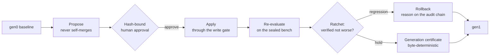

# TrueRise: Harness Governance for Verifiable Recursive Self-Improvement

*Every RSI step, a true rise.* — and a step only counts as a rise when a
stranger can recompute it.

[English](README.md) | [简体中文](README.zh-CN.md)

**TrueRise is the integrity-evaluation layer for agentic claims.** Any
"our agent improved X%" statement should carry a certificate a third party
can recompute offline. This repository ships four things:

- an **anti-cheat bench** where the usual ways of faking an improvement —
  best-of-N with a hidden denominator, thresholds edited after the run,
  self-reported evidence — fail *mechanically*, not by reviewer vigilance;
- a **claim certificate** recomputable **offline** by anyone (model steps
  pinned and taped, byte-deterministic over the same inputs and code — see
  `docs/determinism.md`, tampering fails closed);
- a **causal-integrity engine** that grades WHAT KIND of claim the evidence
  can carry — correlational, causal-observational, causal-interventional —
  with an assumption ledger ("no assumption row, no causal claim"), a
  refuter battery, and lucky-pass detection;
- a **governed Rust runtime** where one RSI generation runs end to end:
  propose → hash-bound human approval → apply → re-evaluate → ratchet →
  rollback on regression.

Every verifiable noun in the title is held to the evidence by a CI gate
(`tools/check_claim_terms.py`): one command, one named test, one committed
artifact each — 5/5 currently met. **No external adoption yet**: everything
below is mechanism evidence from this repository's own runs; the adoption
column opens when an external pipeline, paper, or CI cites these artifacts.

## Why

| Without TrueRise | With TrueRise |
| --- | --- |
| "our agent improved X%" is unverifiable | the claim ships a certificate strangers recompute offline |
| cheating passes the benchmark, if nobody looks closely | each cheat family fails mechanically — one command per failure, table below |
| scores drift between implementations and environments | cross-certification gate + four-part fingerprint; cross-environment comparison is refused |
| unverified conclusions leak into memory, skills, baselines | the write gate: no support reference, no persistent write — and the mark survives into later certificates |
| "the process worked" is unevaluable | the trajectory is step-signed; a lucky pass is detected and NOT scored |

**Who it is for**: evaluation engineers (run the bench against any solver),
harness/agent authors (embed the SDK and make your own claims checkable),
RSI researchers (the gen0→gen1 loop is a reference implementation of
*governed* self-improvement — it never self-merges), and quantitative teams
whose "improvement" claims need an evidence class, not an adjective.

## 60 seconds

```bash
cargo test --workspace                  # 372 Rust tests
python -m pip install -e python/
python -m pytest python/tests -q        # 42 tests
python -m truerise evals demo           # honest PASS, cheater FAIL, mutator FAIL
python -m truerise demo --replay        # a verdict recomputed offline, verdict-identical
cargo run -p truerise-cli -- demo       # the same walkthrough in Rust
python tools/check_dual_impl.py         # Rust and Python verdicts agree field-for-field, or red
cargo run -p truerise-cli -- evolve --replay --cert readings/v0.2/gen1_certificate.json
                                        # one governed RSI generation, recomputed OFFLINE
```

## What it catches — one command per failure

| Evaluation failure | What catches it | Verify in one command |
| --- | --- | --- |
| best-of-N reporting with a hidden denominator | runner-counted monotonic trial ledger; the corrected bar = base/N is printed, then enforced | `python -m truerise evals run --cheat --trials 20 --strategy majority` (FAIL: `corrected significance 2.5e-03`) |
| thresholds picked after the results | thresholds sealed (SHA-256) before the run; the claim map is diffed against the seal, offending keys named | `python -m truerise evals run --mutate` (FAIL: `prereg diff ... keys: min_accuracy, claim_p`) |
| model self-report as evidence | evidence ladder L0–L6; records without an executor signature contribute NOTHING | `python -m truerise demo` (reason 4: `0 executor-signed records`) |
| cross-environment score comparison | four-part fingerprint; comparing across registries is REFUSED, self-vs-self included | `python -m truerise demo --drop-fingerprint` (integrity line appears) |
| verdicts that cannot be re-checked | hash-chained ledger; `--replay` recomputes offline, tamper fails closed with row location | `python -m truerise demo --replay` |
| score regression merged silently | ratchet only tightens; regression → non-zero exit | `cargo test -p truerise-eval` |
| a verdict that cannot be recorded | unrecorded verdicts are ERRORS, not warnings | `cargo test -p truerise-eval` (`judge_and_record`) |
| reward hacking: the evaluated party edits the evaluator | conformance judging authority + sandbox must-fail probes (escape / oversell / residue) | `cargo test -p truerise-sandbox` |
| dual implementations drifting apart | cross-certification gate: same fingerprint, same verdict, field-for-field | `python tools/check_dual_impl.py` |
| an unverified assertion written into memory, skills, or baselines | G29 write gate: four persistent-state paths, one shared door — no support reference, no write; marks survive into later certificates (wired: evolve apply + hat load; SDK baseline declared deferral) | `cargo test -p truerise-governance` |
| an unsigned trajectory step claiming process evidence | G9 stepwise signing: unsigned or tampered steps contribute NO evidence; tampering voids the prefix | `cargo test -p truerise-observe` |
| a lucky pass inflating the score | G10 process grading: lucky passes are detected and NOT scored — they feed a public lucky-pass rate instead | `cargo test -p truerise-eval process` |

## The causal-integrity engine

Most agent claims stop at "correlation". TrueRise makes the evidence class
a first-class, machine-checked object:

- **Claim typology.** Every causal-flavored claim is typed — correlational,
  causal-observational, causal-interventional, predictive,
  measurement-validity, temporal-precedence — and the gate enforces the
  wording: a temporal-precedence or correlational claim may never use
  causal language ("preceded by" is evidence; "caused by" is not).
- **The assumption ledger.** "No assumption row, no causal claim": a
  causal-typed claim must declare SUTVA / consistency / exchangeability /
  positivity with a defense and named evidence, or it DOWNGRADES to
  hypothesis tier — the `INCONCLUSIVE` verdict of the claim layer. Marks
  survive across generations by machinery (the write gate reconstructs
  them from the audit chain, and every generation certificate embeds them).
- **The identification chest.** Manski no-assumption bounds (an
  INCONCLUSIVE verdict with a shape), E-values (the price of unmeasured
  confounding), invariance screening across environments, a refuter battery
  (placebo permutation, bootstrap subset stability, confounder injection,
  negative-control outcomes), difference-in-differences, regression
  discontinuity at routing cutoffs, Wald IV with weak-instrument refusal,
  propensity weighting with fail-closed positivity, synthetic control,
  effect modification, minimal pairs, exact + Monte-Carlo permutation
  tests, and interventional Shapley for component credit.
- **Formal failure attribution.** Halpern-Pearl actual causation with
  Chockler-Halpern responsibility over binary bounded models — "which
  component actually caused the failure" becomes a computable question on
  the signed trajectory, with the canonical preemption result pinned by
  test (the first throw is the cause; the preempted one never is).
- **The honest boundary.** The engine PRICES evidence and REFUSES designs;
  it does not PROVE causality. Identification assumptions remain
  judgements — the machinery forces them to be declared, defends their
  arithmetic, and downgrades claims that skip the paperwork.

`cargo test -p truerise-eval` runs the whole chest: bounds, E-value,
permutation, Shapley, refuters, invariance screening, attribution — plus
the governance gates (`cargo test -p truerise-governance`).

## What is in the box

| Piece | Scope | License |
| --- | --- | --- |
| `truerise` (Python) | the 60-second demo + `truerise.evals` Anti-Cheat Bench + zero-dependency SDK + long-horizon closed-loop packs + external-solver protocol | Apache-2.0 / MIT |
| `truerise` (Rust, 13 crates) | contracts and judging authority: hash-chain audit, three-state policy, sandbox + tool-execution ports (RFC 0002), conformance judge, ratchet, the RSI closed loop (RFC 0003), the write gate, trajectory signing, the causal identification substrate, MCP (zero exposure), observe, PyO3 shell | Apache-2.0 / MIT |
| `truerise-native` (PyO3 wheel) | OPTIONAL accelerator over the same crates; the pure-Python SDK is the complete fallback | Apache-2.0 / MIT |
| task packs (data) | generated fixtures + sealed answers | CC-BY-4.0 (`LICENSE-DATA.md`) |

## One governed RSI generation



The full contract — the only apply path, the approval token as content hash,
rollback semantics — is [RFC 0003](docs/rfc/0003-generation-certificate-and-apply.md).

## Where it fits production

The deployment story is integrations, not a platform lock-in — each row is
a contract shipped and tested in this repository:

| Production surface | What you deploy | The contract |
| --- | --- | --- |
| CI quality gates | the claim-gate pattern against YOUR release notes: every verifiable noun = command + named test + artifact, or the word leaves the title | `tools/check_claim_terms.py` |
| agent releases | run the bench against your solver through the one-file external-solver protocol; ship the recomputable certificate with the release | `docs/integrations.md` |
| compliance / audit | byte-deterministic certificates + a tamper-locating audit chain: a third party recomputes offline, tampering fails closed with row location | `python -m truerise demo --replay` |
| agent SDKs | embed the zero-dependency Python SDK: governed tool execution, budget enforcement, per-run completion certificates | `docs/integrations.md` |
| tool access control | MCP server with zero exposure by default; a hat loads a tool subset, unknown tools refuse the run | `docs/integrations.md` |
| RSI programs | the gen0→gen1 loop as the reference for governed self-improvement — approval-gated, never self-merging | RFC 0003 |

One honest boundary: the same contracts run in an internal production
system that is deliberately outside this repository (license isolation).
What this repository claims is the machinery, not the deployment count.

## Reference readings (committed, offline-recomputable)

| Run | Verdict | Artifact |
| --- | --- | --- |
| honest solver, 1 trial | PASS, accuracy 100% (120/120) | [`readings/v0.1/honest_verdict.json`](readings/v0.1/honest_verdict.json) |
| cheater, 20 trials, majority | FAIL — hidden denominator caught | [`readings/v0.1/cheater_verdict.json`](readings/v0.1/cheater_verdict.json) |
| mutator | FAIL — threshold mutation caught | [`readings/v0.1/mutator_verdict.json`](readings/v0.1/mutator_verdict.json) |
| gen0 → gen1 closed loop | lineage certificate, byte-recomputable | [`readings/v0.2/gen1_certificate.json`](readings/v0.2/gen1_certificate.json) |

Technical report: [`docs/report/anti_cheat_bench_v0.1.md`](docs/report/anti_cheat_bench_v0.1.md).

## Documentation

| Read | What you get |
| --- | --- |
| [`docs/quickstart.md`](docs/quickstart.md) | install, first run, first verdict, first tamper drill |
| [`docs/cli.md`](docs/cli.md) | the authoritative subcommand/flag list with the exit-code contract |
| [`docs/anti_cheat_bench.md`](docs/anti_cheat_bench.md) | the bench protocol: pack format, sealed taxonomy, isolation, certificate schema |
| [`docs/arch.md`](docs/arch.md) | hexagonal ports-and-adapters, crate map, the three books |
| [`docs/determinism.md`](docs/determinism.md) | the three scoped determinism claims + the honest boundary |
| [`docs/integrations.md`](docs/integrations.md) | MCP, the Python SDK, the external-solver protocol |
| [`docs/README.md`](docs/README.md) | the full index (all user-facing docs ship as EN/zh-CN pairs) |

## Limitations (read before citing)

- **No external model run yet.** Every reading above comes from our own
  reference solvers. The external-solver protocol has landed; the missing
  step is operational — one public model behind a solver honouring the
  contract ([`ROADMAP.md`](ROADMAP.md) item 1). Until then, treat the bench
  as a harness demo, not a leaderboard.
- **The internal production deployment is not in this repository.** The same
  contracts run in a separate source-available system; license isolation
  keeps it out by design. We say so plainly rather than implying an adoption
  this repository cannot show.
- **Solo project.** One author, DCO-signed; the RFC process is where
  external review starts.
- **No RL training results.** The runtime exposes interfaces a training
  loop can consume safely; we claim no training-loop outcome.
- **The causal engine prices evidence; it does not prove causation.**
  Identification assumptions remain judgements — the machinery demands
  they be declared and defended, and downgrades what is not.

## Status

Pre-release (`0.2.0-dev.0`). 13 Rust crates + a zero-dependency Python SDK
(+ an optional PyO3 accelerator), 15 gate scripts behind 15 CI jobs, every
commit DCO-signed. 372 Rust tests + 42 Python tests green; 63 behaviour
rows spec-mapped to 324 named identifiers (machine-checked); claim gate
5/5 met. Wave-by-wave evidence in [`CHANGELOG.md`](CHANGELOG.md); forward
plan in [`ROADMAP.md`](ROADMAP.md).

## Contributing

DCO sign-off + IP-clean declarations ([`CONTRIBUTING.md`](CONTRIBUTING.md)).
The main funnel is one task pack = one PR
([`docs/task_pack_guide.md`](docs/task_pack_guide.md)). Port-trait and
wire-schema changes go through RFCs ([`docs/rfc/README.md`](docs/rfc/README.md)).

## Security

See [`SECURITY.md`](SECURITY.md). Every executed action flows through the
sandbox port and lands on the audit chain with the executor's capability
level; secrets never enter the repository, argv, or logs.

## License

Code dual-licensed **Apache-2.0 / MIT** (`LICENSE-APACHE`, `LICENSE-MIT`);
task packs CC-BY-4.0 (`LICENSE-DATA.md`).

## Citation

See [`CITATION.cff`](CITATION.cff).
