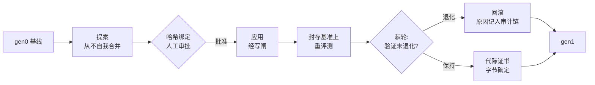

# TrueRise：面向可验证递归自我改进的Harness治理框架

*每一步RSI自进化，都是真实的提升。* —— 只有陌生人能够离线复算，这一步才算作提升。

[English](README.md) | [简体中文](README.zh-CN.md)

**TrueRise 是面向智能体声明的诚信评测层。** 任何"我们的 agent 提升了 X%"
这类声明，都应当附带一张第三方可离线复算的证书。本仓库交付四样东西：

- **反作弊基准**：伪造提升的常见手段——隐藏分母的 N 择优、事后改阈值、
  自报当证据——在*机制层面*失效，不靠评审员眼力；
- **声明证书**：任何人可**离线复算**（模型步骤钉扎并录制、同输入同代码下
  字节级确定——见 `docs/determinism.md`，篡改即闭锁失败）；
- **因果诚信引擎**：给证据能承载的声明**分等级**——相关、观测因果、干预
  因果——配套假设台账（"无假设行，则无因果宣称"）、refuter 电池与侥幸
  通过检测；
- **受治理的 Rust 运行时**：一次 RSI 代际端到端跑通：提案 → 哈希绑定人工
  审批 → 应用 → 重评测 → 棘轮 → 退化即回滚。

标题里每一个可核验名词都由 CI 门禁约束（`tools/check_claim_terms.py`）：
一条命令、一项具名测试、一份入库工件——当前 5/5 达标。**暂无外部采用**：
下文全部证据来自本仓库自身运行；当外部流水线、论文或 CI 引用这些工件时，
采用状态栏开启。

## 为什么

| 没有 TrueRise 之前 | 有 TrueRise 之后 |
| --- | --- |
| "我们的 agent 提升了 X%"无法核验 | 声明附带证书，陌生人可离线复算 |
| 没人细看，作弊就能过基准 | 每类作弊机制性失败——一类一条核验命令，见下表 |
| 分数在实现与环境间漂移 | 交叉认证门 + 四段式指纹；跨环境对比直接拒绝 |
| 未经验证的结论渗入记忆、技能、基线 | 写闸：无支撑引用，不落持久状态——标记在后续证书中持续可见 |
| "过程没问题"无法评估 | 轨迹逐步签名；侥幸通过被检出且**不计分** |

**适用人群**：评测工程师（用基准测任意求解器）、Harness/agent 作者（嵌入
SDK，让你自己的声明可核验）、RSI 研究者（gen0→gen1 闭环是*受治理*自我
改进的参考实现——它从不自我合并）、以及需要证据等级而非形容词的定量
团队。

## 60 秒上手

```bash
cargo test --workspace                  # 372 项 Rust 测试
python -m pip install -e python/
python -m pytest python/tests -q        # 42 项测试
python -m truerise evals demo           # 诚实 PASS，作弊 FAIL，篡改 FAIL
python -m truerise demo --replay        # 判定结果离线复算，判词一致
cargo run -p truerise-cli -- demo       # Rust 版同款演示
python tools/check_dual_impl.py         # Rust 与 Python 判定逐字段一致，否则红
cargo run -p truerise-cli -- evolve --replay --cert readings/v0.2/gen1_certificate.json
                                        # 一次受治理 RSI 代际，离线复算
```

## 能拦住什么——一类问题一条核验命令

| 评估失效 | 拦截机制 | 一条命令核验 |
| --- | --- | --- |
| 隐藏分母的 N 择优汇报 | 运行器维护单调试验台账；修正线 = 基线/N 打印后强制执行 | `python -m truerise evals run --cheat --trials 20 --strategy majority`（FAIL：`corrected significance 2.5e-03`） |
| 看完结果再挑阈值 | 阈值运行前 SHA-256 封存；声明映射与封存比对，违规键逐个点名 | `python -m truerise evals run --mutate`（FAIL：`prereg diff ... keys: min_accuracy, claim_p`） |
| 模型自报当证据 | 证据阶梯 L0–L6；无执行器签名的记录**毫无证明力** | `python -m truerise demo`（原因 4：`0 executor-signed records`） |
| 跨环境对比分数 | 四段式指纹；跨注册表对比拒绝，自比亦禁 | `python -m truerise demo --drop-fingerprint`（出现完整性提示） |
| 判定结果无法复核 | 哈希链台账；`--replay` 离线重算，篡改闭锁失败并定位行号 | `python -m truerise demo --replay` |
| 分数退化被静默合并 | 棘轮只收紧；退化 → 非零退出码 | `cargo test -p truerise-eval` |
| 判定结果不落档 | 未落档判定是**错误**而非警告 | `cargo test -p truerise-eval`（`judge_and_record`） |
| 奖励劫持：被测方改评估器 | 合规裁决权威 + 沙盒必败探针（逃逸/夸大/残留） | `cargo test -p truerise-sandbox` |
| 双实现漂移 | 交叉认证门：同指纹、同判定、逐字段一致 | `python tools/check_dual_impl.py` |
| 未经验证的断言写入记忆、技能、基线 | G29 写闸：四条持久路径一扇共享门——无支撑引用不落盘；标记在后续证书中持续可见（已接线：evolve 应用 + 帽装载；SDK 基线面声明缓做） | `cargo test -p truerise-governance` |
| 未签名的轨迹步冒充过程证据 | G9 逐步签名：未签名或被篡改的步**零证据**；篡动作废整个前缀 | `cargo test -p truerise-observe` |
| 侥幸通过抬高分数 | G10 过程判卷：侥幸通过被检出且**不计分**——只进公开的侥幸通过率 | `cargo test -p truerise-eval process` |

## 因果诚信引擎

多数 agent 声明停在"相关"。TrueRise 把证据等级变成一等公民、机器可查
的对象：

- **声明类型学。** 每条因果色彩声明都被分型——相关、观测因果、干预因果、
  预测、测量效度、时序先后——门禁执法措辞：时序先后或相关类声明**不得**
  使用因果措辞（"先于"是证据；"导致"不是）。
- **假设台账。** "无假设行，则无因果宣称"：因果类声明必须声明 SUTVA /
  一致性 / 可交换性 / 正性并给出辩护与具名证据，否则**降级**为假设档——
  即声明层的 `INCONCLUSIVE` 判词。标记跨代幸存是机制（写闸从审计链重建，
  每张代际证书嵌入标记行）。
- **识别工具箱。** Manski 无假设界（带形状的 INCONCLUSIVE 判词）、E-value
  （未测混杂的定价）、跨环境不变性筛查、refuter 电池（安慰剂置换、自助
  子集稳定性、混杂注入、阴性对照结局）、双重差分、路由断点的断点回归、
  弱工具拒收的 Wald IV、正性 fail-closed 的倾向加权、合成控制、效应修饰、
  最小对、精确 + 蒙特卡洛置换检验、组件归因的干预式 Shapley。
- **形式化失败归因。** 二值有界模型上的 Halpern-Pearl 实际因果 +
  Chockler-Halpern 责任度——"哪个组件实际导致了失败"在签名轨迹上成为
  可计算问题，规范抢占结果由测试钉死（第一块石头是原因；被抢占的那块
  永远不是）。
- **诚实边界。** 引擎给证据**定价**、对设计**拒收**；它不**证明**因果。
  识别假设仍是判断——机制强制其被声明、守护其算术、把跳过文书者降级。

`cargo test -p truerise-eval` 跑全工具箱：界、E-value、置换、Shapley、
refuter、不变性筛查、归因——外加治理门（`cargo test -p truerise-governance`）。

## 交付物清单

| 组件 | 覆盖范围 | 许可 |
| --- | --- | --- |
| `truerise`（Python） | 60 秒演示 + `truerise.evals` 反作弊基准 + 零依赖 SDK + 长程闭环任务包 + 外部求解器协议 | Apache-2.0 / MIT |
| `truerise`（Rust，13 crates） | 契约与裁决权威：哈希链审计、三态策略、沙盒与工具执行端口（RFC 0002）、合规裁决器、棘轮、RSI 闭环（RFC 0003）、写闸、轨迹签名、因果识别底座、MCP（默认零暴露）、观测导出、PyO3 壳 | Apache-2.0 / MIT |
| `truerise-native`（PyO3 wheel） | 可选加速器，复用同一套 crates；纯 Python SDK 是完备兜底 | Apache-2.0 / MIT |
| 任务包（数据） | 生成夹具（题料）+ 封存答案 | CC-BY-4.0（`LICENSE-DATA.md`） |

## 一次受治理的 RSI 代际



完整契约——唯一 apply 路径、审批令牌即内容哈希、回滚语义——见
[RFC 0003](docs/rfc/0003-generation-certificate-and-apply.md)。

## 在生产中如何落地

落地方式是集成契约，不是平台绑定——每行都是本仓库交付并测试过的契约：

| 生产面 | 你部署什么 | 契约 |
| --- | --- | --- |
| CI 质量门 | 把宣称门模式套到你自己的发布说明上：每个可核验名词 = 命令 + 具名测试 + 工件，否则该词离开标题 | `tools/check_claim_terms.py` |
| agent 发布 | 经单文件外部求解器协议用基准测你的求解器；随发布附带可复算证书 | `docs/integrations.md` |
| 合规 / 审计 | 字节确定证书 + 可定位篡改行的审计链：第三方离线复算，篡改闭锁失败并定位行号 | `python -m truerise demo --replay` |
| agent SDK | 嵌入零依赖 Python SDK：受治理工具执行、预算执法、逐次运行完成证书 | `docs/integrations.md` |
| 工具访问控制 | MCP 服务器默认零暴露；帽装载工具子集，未知工具拒绝运行 | `docs/integrations.md` |
| RSI 项目 | gen0→gen1 闭环作为受治理自我改进的参考——审批门控、从不自我合并 | RFC 0003 |

一条诚实边界：同一套契约运行在一个内部生产系统中，该系统按许可隔离
**刻意**不在本仓库内。本仓库声明的是机制，不是部署数量。

## 参考评测记录（已入库，可离线复算）

| 运行 | 判定 | 工件 |
| --- | --- | --- |
| 诚实求解器，1 次试验 | PASS，准确率 100%（120/120） | [`readings/v0.1/honest_verdict.json`](readings/v0.1/honest_verdict.json) |
| 作弊求解器，20 次试验，多数策略 | FAIL——隐藏分母被捕获 | [`readings/v0.1/cheater_verdict.json`](readings/v0.1/cheater_verdict.json) |
| 篡改者 | FAIL——阈值篡改被捕获 | [`readings/v0.1/mutator_verdict.json`](readings/v0.1/mutator_verdict.json) |
| gen0 → gen1 闭环 | 谱系证书，字节可复算 | [`readings/v0.2/gen1_certificate.json`](readings/v0.2/gen1_certificate.json) |

技术报告：[`docs/report/anti_cheat_bench_v0.1.md`](docs/report/anti_cheat_bench_v0.1.md)。

## 文档

| 阅读 | 你得到什么 |
| --- | --- |
| [`docs/quickstart.md`](docs/quickstart.md) | 安装、首次运行、首张判定、首次篡改演练 |
| [`docs/cli.md`](docs/cli.md) | 权威子命令/参数清单与退出码契约 |
| [`docs/anti_cheat_bench.md`](docs/anti_cheat_bench.md) | 基准协议：题包格式、封存分类、隔离、证书 schema |
| [`docs/arch.md`](docs/arch.md) | 六边形端口-适配器、crate 图、三本台账 |
| [`docs/determinism.md`](docs/determinism.md) | 三条限定范围的确定性承诺 + 诚实边界 |
| [`docs/integrations.md`](docs/integrations.md) | MCP、Python SDK、外部求解器协议 |
| [`docs/README.md`](docs/README.md) | 完整索引（所有用户文档均为中英对） |

## 局限（引用前必读）

- **尚无外部模型运行。** 上文全部读数来自我们自己的参考求解器；外部求解器
  协议已落地，缺的是运营步骤——一个遵守契约的求解器背后的公开模型
  （[`ROADMAP.md`](ROADMAP.md) 第 1 项）。在此之前，本基准是 harness 演示，
  不是排行榜。
- **内部生产部署不在本仓库。** 同一契约运行在另一套源码可用系统中；许可
  隔离使其刻意留在仓外。我们直说，而不是暗示仓库无法展示的采用量。
- **单人项目。** 一位作者，DCO 签名；RFC 流程是外部评审的入口。
- **无 RL 训练结果。** 运行时暴露训练循环可安全消费的接口；我们不声称
  任何训练循环产出。
- **因果引擎为证据定价，不证明因果。** 识别假设仍是判断——机制强制其被
  声明与辩护，并把未声明者降级。

## 状态

预发布（`0.2.0-dev.0`）。13 个 Rust crates + 零依赖 Python SDK（+ 可选
PyO3 加速器），15 门脚本对应 15 个 CI job，每个提交 DCO 签名。372 项 Rust
测试 + 42 项 Python 测试全绿；63 条行为行映射到 324 个具名标识符（机器
校验）；宣称门 5/5 达标。逐波证据见 [`CHANGELOG.md`](CHANGELOG.md)；前瞻
计划见 [`ROADMAP.md`](ROADMAP.md)。

## 贡献

DCO 签名 + IP 清洁声明（[`CONTRIBUTING.md`](CONTRIBUTING.md)）。主通道是
一个任务包 = 一条 PR（[`docs/task_pack_guide.md`](docs/task_pack_guide.md)）。
端口 trait 与线协议变更走 RFC（[`docs/rfc/README.md`](docs/rfc/README.md)）。

## 安全

见 [`SECURITY.md`](SECURITY.md)。每个被执行的动作流经沙盒端口、落入审计链
并附带执行器能力等级；密钥不进仓库、argv 或日志。

## 许可

代码双许可 **Apache-2.0 / MIT**（`LICENSE-APACHE`、`LICENSE-MIT`）；任务包
数据 CC-BY-4.0（`LICENSE-DATA.md`）。

## 引用

见 [`CITATION.cff`](CITATION.cff)。
